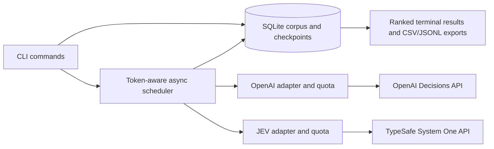

> Historical design plan. See README.md and docs/CLI.md for shipped behavior; unimplemented roadmap items here are not release claims.

# Abstract Sift: implementation plan

Draft, 2026-10-26. Product name is provisional. Current scope: **a decision-model CLI supporting OpenAI Decisions, TypeSafe JEV, or both, with user-supplied API keys**. This is a design proposal, not a claim that performance or API integrations have already been tested.

## 1. Product outcome and CLI experience

Help a researcher screen every available abstract against their research interests and export a prioritized reading list. Start with a command-line application; retain a reusable engine so a browser interface can be added later.

Proposed commands (design examples; not implemented):

```bash
# Supply OPENAI_API_KEY and/or TYPESAFE_API_KEY, or use hidden prompts.
abstract-sift import abstracts.jsonl --corpus esmo2026
abstract-sift search --corpus esmo2026 --query-file interests.txt --top 30
abstract-sift estimate --corpus esmo2026 --query-file interests.txt --provider both
abstract-sift score --corpus esmo2026 --query-file interests.txt --provider openai --max-cost-usd 2
abstract-sift score --corpus esmo2026 --query-file interests.txt --provider jev --max-cost-usd 2
abstract-sift score --corpus esmo2026 --query-file interests.txt --provider both --max-cost-usd 2
abstract-sift status RUN_ID
abstract-sift results RUN_ID --top 50
abstract-sift compare RUN_ID
abstract-sift cost RUN_ID --json
abstract-sift results RUN_ID --view discordant --top 50
abstract-sift export RUN_ID --format csv --output ranked-abstracts.csv
abstract-sift resume RUN_ID --max-additional-cost-usd 1
```

Provider selection is explicit: `openai`, `jev`, or `both`. Only selected providers receive data and need credentials. Both mode evaluates every eligible abstract independently with both models. The interest file contains free text and optional explicit inclusion/exclusion criteria. Preserve its exact contents. Optional inline query input is convenient but should note shell-history exposure for private research interests.

`score` prints a run ID immediately and periodically reports evaluated/total, failures, relevant/review counts, elapsed time, observed throughput, estimated remaining time, and usage. The command remains in the foreground. Ctrl+C stops scheduling and checkpoints completed work; `resume` processes unfinished rows. Resumption validates the corpus/query/rubric version and requires the key again. Independent `status` and `results` commands can inspect a running job.

Write progress to stderr, machine-readable output to stdout, and results to SQLite. Support `--json` for automation; no terminal animations when output is redirected. Use meaningful exit codes for complete, partial/canceled, authentication/quota, and invalid-input outcomes. CSV/JSONL exports include source links and can be opened in ordinary spreadsheet software.

Model labels: relevant, needs review, not relevant. Processing states: queued, evaluating, completed, missing text, refused, failed, canceled. Failures and missing evidence never count as negative judgments. Optional binary output uses an explicit threshold and documented handling of the review band. A manual-review import can later preserve human annotations separately from model judgments.

Out of scope: ChatGPT sign-in, Responses inference, generated prose explanations, web UI, hosted service, poster-image scoring, and clinical recommendations.

## 2. Provider selection and comparable scoring

Use a provider-neutral scoring engine with two provider adapters. Both evaluate the same canonical research question, inclusion/exclusion rubric, and scientific text. No OAuth or generative inference is planned.

| Provider | Endpoint | Primary question | Credential | Initial model choice |
| --- | --- | --- | --- | --- |
| OpenAI | `POST https://api.openai.com/v1/decisions` | `predicate` | `OPENAI_API_KEY` | `gpt-6-luna` |
| TypeSafe JEV | `POST https://api.typesafe.ai/v1/systemone` | `noul` | `TYPESAFE_API_KEY` | Pinned `jev-1.14.0`, subject to access check |

Use the official TypeSafe service, not an unverified similarly named proxy. [API notes](API_NOTES.md) record the sources. JEV's named-answer map and OpenAI's answer array require separate serializers/validators. Both map to a canonical probability that **this abstract is relevant**; retain raw provider fields as well.

A result records `(run_id, abstract_id, provider)`, status, relevance label, raw probability, requested and returned model IDs, rubric version, canonical evidence hash, wire-request hash, source provenance, batch composition, and timings. The two providers share a relevance definition, not an assumption of equal calibration. Never send one provider the other's answers.

Put the common user-interest/rubric text in shared `input` (OpenAI) or `state` (JEV), and each candidate's scientific text in its own question instructions. Keep equivalent text and delimiters in both encodings. The examples use the same fictional candidates: [OpenAI](../examples/decisions-request.json), [JEV](../examples/jev-request.json). These payloads have not been sent to either API.

If one provider cannot accept an abstract's evidence, mark that provider's item unscored; do not silently truncate it or compare different texts. Provider-specific packing can differ, but benchmark each against a one-abstract baseline. Changing the rubric or evidence invalidates the pair. Model aliases must be resolved/recorded; do not mix returned builds within an undifferentiated comparison.

Define relevance as scientific evidence addressing the user's interests while satisfying explicit constraints. Mentioning a disease or drug alone is insufficient. Negative findings can be relevant. Treat embedded instructions as untrusted abstract content. Preserve distinctions among population, intervention, biomarker, study design, and disease stage.

Sort initially by estimated relevance probability and expose a review band. Tune thresholds on labeled examples, prioritizing recall. If relevance probability does not adequately prioritize reading, benchmark a second 0–3 match-strength question. This doubles the question count per abstract and must justify its added latency and cost. Relevance probability and importance are different quantities.

No generated explanations in the decision-model MVP. Show the source abstract and the actual predicate/rubric used. Later, predefined diagnostic predicates could flag population or intervention mismatch, but do not present those flags as generated rationales or verified quotations.

## 3. Fast interaction without losing coverage

Three layers:

- **Immediate preview:** prebuilt local full-text index, weighted toward title and scientific sections. Target under 200 ms for warmed local queries on a 5,000-record corpus. Label results “search preview,” not “AI evaluated.” A local embedding index is an optional later improvement if lexical retrieval misses too many synonyms.
- **Progressive judgments:** evaluate likely matches first, then every remaining usable abstract. First-result latency matters more than waiting for a complete sort. No top-k cutoff in the default Evaluate all mode.
- **Exact-result reuse:** reuse judgments only when query, criteria, abstract content, provider/model, and rubric versions match. Threshold changes and sorting are local operations and should complete immediately without model calls. Similar but different queries must not reuse judgments as if identical.

Use separate bounded asynchronous request pools, connection pools and quota state for OpenAI and TypeSafe, with an overall memory/network cap. In both mode, launch the pools concurrently; results from the faster provider appear immediately without waiting for the other. Use a bounded asynchronous request pool per provider. Benchmark batch sizes 1, 8, 32, 64, and 128 with concurrency 1, 4, 8, and 16. Start conservatively at four in-flight calls; increase only while request/token budgets and observed error rates permit. Pack by both question count and measured tokens, splitting unusually long records into their own requests rather than truncating scientific evidence. Verify the endpoint's current context/body limits in the integration spike.

OpenAI’s 400-question ceiling is not the recommended batch size and must not be applied to JEV. TypeSafe documents separate request and per-question context limits; packing must obey both. Keep provider capability limits and token estimation separate, and disable experimental long-context extensions by default. Larger batches amortize network overhead but delay the first result, increase retry cost, and can cause cross-abstract contamination. Compare batched judgments against single-abstract judgments and test sensitivity to neighboring abstracts and ordering.

Keep a token-budget scheduler and per-account concurrency limiter for each provider. A provider outage pauses only that provider; preserve the other’s results, explicitly mark incomplete pairs, and resume only missing provider/item evaluations. No automatic provider substitution. Honor server retry hints; use jittered backoff for transient failures; pause on authentication/quota errors. Stop scheduling promptly on cancel, abort active HTTP calls where possible, and explain that already processed requests can still incur usage. Resume from durable per-abstract checkpoints.

Validate answer IDs, types, ranges, and refusals before saving results. Update console progress as whole requests finish; do not assume Decisions streams individual answers. Save successful questions even if another question in the same response refuses.

Cache experiment: compare query-shared requests against fixed abstract shards in shared input with query-dependent questions. The latter could help repeated corpus scans, but must demonstrate useful cache hits, correct isolation, and better latency/cost. Do not rely on caching a short user query or assume cold concurrent requests already have cache hits.

## 4. Realistic latency and cost model

Current local corpus measurements:

| Measure | Value |
| --- | ---: |
| Catalogue entries | 4,418 |
| Clean HTML abstracts | 4,284 |
| HTML requests unavailable | 134 |
| Of those, PDF text exists | 91 |
| Neither source available | 43 |
| Total HTML-derived text | 20,274,086 characters |
| Median / p95 / maximum length | 3,420 / 11,773 / 26,831 characters |

These are measurements of the private corpus, not redistributed source content. Full text includes metadata and disclosures. A deterministic section extractor can omit author affiliations and disclosures from relevance scoring while retaining scientific sections, tables, and the complete original for display. Unrecognized layouts retain full text and get a flag; no generative summaries as the only scoring evidence.

A rough four-characters-per-token approximation yields 5.07 million tokens before request overhead. At the documented Decisions uncached input rate, that is about $0.51 for one input pass, before overhead, repeats, cache-write charges, or pricing modifiers. This is a planning estimate, not a quote; measure actual token usage and payload billing during the spike. See [pricing source](https://developers.openai.com/api/docs/guides/decisions).

Throughput lower bound:

`seconds >= max(total_input_tokens / allowed_TPM * 60, request_count / allowed_RPM * 60, request_waves * observed_request_latency)`

For illustration, 5.07 million input tokens alone take about 304 seconds at 1 million TPM, or 30 seconds at 10 million TPM, before other bottlenecks. These limits are hypothetical examples, not promised account entitlements. Both-mode runtime is approximately bounded by the slower provider pipeline, rather than the sum, when run concurrently; request packing and local contention still matter. More threads cannot remove that bound.

Targets to test, not guarantees: warmed preview under 200 ms p95; exact cached results under 300 ms; first Decisions results within 2 seconds p95 where account capacity permits. Report total-scan time with the model and actual account limits. Do not promise instantaneous fresh model scoring of 4,000+ full abstracts. If the measured full scan is slow, make intermediate results inspectable while it completes.

## 5. Console architecture

Python CLI, asyncio scheduler, separate pooled asynchronous HTTP connections to the two official providers, SQLite job/result storage, and SQLite full-text search. Use a maintained CLI parser and optional terminal progress library; pin exact dependencies during implementation. No frontend, local HTTP server, Node runtime, or cloud VM is needed.



The CLI reduces implementation and operational complexity. It does not by itself accelerate remote inference; throughput comes from batching, connection reuse, rate-aware concurrency and avoiding duplicate work. Benchmark before adding multiprocessing: this workload is primarily remote I/O, and multiple independent processes can compete for the same account quota.

Future layout:

```text
src/abstract_sift/
  cli.py           # import, search, estimate, score, resume, status, results, export
  importers/       # CSV/JSONL and deterministic scientific-section extraction
  scoring/         # rubric, token packing, async scheduler, result validation
  providers/       # OpenAI and TypeSafe transport, capabilities, retry and usage
  comparison/      # pairing, agreement, ranking and review queues
  storage/         # SQLite migrations, checkpointing and cache keys
benchmarks/
tests/fixtures/    # synthetic/licensed content only
docs/
examples/
```

Domain records: Corpus, Abstract, SourceVersion, ResearchQuery, RubricVersion, EvaluationRun, ProviderRun, AbstractDecision, ComparisonReport, and later HumanReview. Use corpus-scoped IDs. Record model, content hashes, source quality, timestamps, tokens and errors. Keep complete source text for viewing even when deterministic scoring sections are shorter.

Use SQLite WAL for concurrent readers, one serialized writer, atomic batches, and a per-run lock to prevent duplicate resumes. Recover in-flight work after a crash; this can repeat a provider request whose result was never persisted, so record that billing limitation. Checkpoint after each validated response. Do not publish a partially parsed response as completed.

A single installed launcher should work on macOS/Linux, with Windows compatibility tested before claiming support. Configuration and corpora live in a user data directory, not the source checkout. Runs are foreground by default; document terminal multiplexers for unattended remote use instead of building a daemon in v1.

## 6. Data quality and import

The existing five-column exports are the first import format, but there must be no hardcoded ESMO paths. Keep this repository portable; data stays in a user-selected directory outside version control.

Use HTML-derived text by default. Offer an explicit import option to fill the 91 HTML gaps with existing PDF-derived text, marking those rows `source=pdf` and lower extraction quality. Preserve the original text; clean wrapping conservatively. The remaining 43 receive `missing_text`, and are not falsely shown as evaluated. Optional title-only triage must be visibly distinct from full-abstract assessment.

Validate UTF-8, duplicate IDs, required fields, broken URLs, empty text, and record sizes. Present an import summary before scoring. Escape imported HTML when rendering, and neutralize spreadsheet formulas on CSV export. Do not fetch arbitrary links during import or evaluation.

## 7. Credentials, cost controls, and open source

Read `OPENAI_API_KEY` and/or `TYPESAFE_API_KEY` for selected providers from the environment or prompt without echo. Preflight both credentials before a both-mode run; never silently downgrade to a single provider. Send each key only to its corresponding official host. Never accept a secret as a command-line flag, print it, put it into SQLite, or include it in exports. Optional OS-keychain storage can follow later. No developer-owned key fallback, OAuth registration, or browser credential handling.

Before scoring, show the corpus size, evidence source, estimated request/token count and expected cost range. Require a user-selected total run budget; also support per-provider caps. Reserve from the shared total atomically across both pools so parallel workers cannot each spend the entire allowance. Display provider-specific estimates; do not use OpenAI pricing to estimate JEV. Reject a dollar-capped run if a provider price is unknown, until the user supplies an explicit rate assumption. Reserve conservative estimated cost for in-flight batches before dispatch; reconcile returned usage and count retries. Stop new work when the budget is exhausted. A local estimate is not an absolute billing cap: tokenizer/pricing differences, repeated requests and in-flight work must be disclosed. Resume specifies an additional budget, with lifetime totals retained.

Log operational counters, timings, request IDs and error classes, not keys or research text. Telemetry is off by default. Abstract content never invokes tools, follows URLs, or changes application instructions. Authentication/quota failures pause the queue and preserve progress.

Publish code and synthetic fixtures separately from the conference corpus. Selected code license: MIT (confirmed 2026-10-27; supersedes the original Apache-2.0 proposal). Do not redistribute the ESMO archive, derived restricted datasets or asset tokens as part of the repository; provide configurable import instructions.

CI covers formatting/types, unit/integration tests with mocked API responses, dependency checks and secret scanning. A clean clone runs tests without private data or API credentials. Live benchmarks are opt-in and cost-bounded; untrusted pull requests receive no API secrets.

Detailed accounting is specified in [per-run cost tracking](COST_TRACKING.md): durable request-attempt ledger, per-provider and combined totals, retry/timeout uncertainty, versioned pricing, and lifetime costs across resumes. Both-mode comparisons must show how much each provider and each paired evaluation cost. These are usage-derived estimates unless reconciled with authoritative billing.

## 8. Evaluation and implementation milestones

| Milestone | Deliverable | Exit criteria |
| --- | --- | --- |
| 0: API and throughput spike | Both provider capability checks; token measurement; independent batching/concurrency benchmarks | Both schemas validated live; actual latency/cost measured; batched judgments compared with single-abstract baselines |
| 1: CLI and corpus | Import, search, estimate, SQLite state and synthetic fixtures | Correct counts and provenance; missing data visible; works without private archive |
| 2: End-to-end screening | OpenAI/JEV/both modes, progress, cancel/resume, shared and per-provider budgets, durable cost ledger, export | Every eligible provider/item pair accounted for; independent recovery; no paid work from search/status |
| 3: Comparison | Paired reports, review queues, agreement/ranking metrics and coverage counts | Missing pairs excluded transparently; metrics tested on hand-calculated fixtures; compatible inputs enforced |
| 4: Quality and public release | Labeled evaluation, reproducible benchmark report, packaging and documentation | Quality targets met on held-out cases; clean install; no private material or credentials in repo |

Start with synthetic smoke tests, then a representative user-selected corpus sample. Benchmark abstract length, question count, token-packed batch size, concurrency and cold/warm cache state. Measure first result, time to 50/500/all judgments, p50/p95, 429s, retries, token use and cost by provider and combined. Measure paired-completion latency separately from the first provider’s output. Give each benchmark an explicit dollar/request budget.

Build expert labels for roughly 500–1,000 query/abstract pairs across 10–20 interest profiles. Include synonyms, exclusions, negative findings, related but wrong disease subtypes, observational studies versus trials, biomarkers, and missing evidence. Separate rubric tuning from held-out evaluation. Suggested acceptance targets: at least 95% relevant-item recall with review-band items retained, strong precision@50, and stable batching behavior. These are goals, not demonstrated results; report uncertainty and subgroup failures.

Test injected instructions, refusal answers, malformed/duplicate/missing IDs, out-of-range probabilities, authentication expiry, rate limiting, exhausted budgets, cancellation, crash recovery, per-run locking and cache invalidation. Preserve scientific tables and long abstracts. Test stdout/stderr behavior and CSV formula escaping. Do not fabricate API measurements from mocked responses.

## 9. Concordance, discordance and review

Comparison is a first-class output, not an automatic average of the two scores. See [comparison specification](COMPARISON.md) for pairing rules, formulas, denominators, edge cases and acceptance tests.

Default wide-net review policy: retain an abstract if either provider calls it relevant or uncertain. Prioritize both-positive papers for reading, surface strong opposite decisions in a separate review queue, and retain all other results for inspection. Only paired negatives qualify for a “both negative” bucket. Single-provider failures cannot cause exclusion. This is a review policy, not a proven accuracy improvement.

Reports include a 3×3 label-agreement table, paired coverage, binary agreement/Cohen's kappa under a separately specified threshold, positive and negative agreement, rank correlation and top-k overlap, and descriptive raw-probability gaps. Every aggregate shows its denominator and threshold/calibration version. Same-label large gaps and outright label conflicts are distinct.

Use human labels to measure each model’s precision/recall/calibration and test whether the union/review policy improves recall at an acceptable workload. High agreement is not correctness: two models may share errors. Do not claim two-model superiority without held-out evaluation.

## 10. Scope decisions and remaining gates

Agreed: console-first, API-key-based decision-model screening with explicit OpenAI-only, JEV-only, and both modes. Every eligible abstract is assessed by each selected provider. Both mode supports agreement/discordance analysis from the first release. Keep the engine extensible without adding unrequested providers now.

No ChatGPT sign-in, Responses generation, or browser interface is in the current scope. The clean repository remains separate from private downloads. Next is the dual-provider capability and throughput spike, followed by the CLI and comparison engine. License confirmed as MIT; validate speed and usefulness before making claims.
